# TP 204 : Etude de cas - Benchmark de performances des Web Services REST

Trois implementations REST du meme catalogue, mesurees avec JMeter sur un jeu de donnees de 100 000 articles et 2 000 categories.

## Le projet en deux mots

Le sujet demande de repondre a une question simple : a modele de donnees identique et a contrats d'API identiques, quelle technologie REST tient le mieux la charge ?

Pour y repondre, trois serveurs ont ete ecrits et laisses tourner en parallele sur trois ports differents. Le premier est en Jersey avec Hibernate, le deuxieme en Spring Boot avec des controleurs ecrits a la main, le troisieme en Spring Data REST. Les trois lisent la meme base MariaDB et exposent exactement les memes URI.

Un plan JMeter unique par variante et par scenario a ensuite envoye la charge. Tout ce qui est visible dans les captures ci-dessous sort de ces executions reelles : les serveurs ont demarre, les requetes sont parties, les fichiers de resultats ont ete ecrits, puis agreges.

## La personnalisation du travail

Le groupe Java est ma.ahmedbenidar.benchmark et chaque variante porte son propre artefact. Le jeu de donnees ne reprend pas les noms generiques du sujet : c'est un catalogue de distribution marocaine, ou les categories s'appellent Informatique, Telephonie, Electromenager, Mobilier, Eclairage et ou les articles portent une reference de type SKU et une description editoriale. Les donnees sont produites par un generateur maison dont la graine est fixee a 20261103, ce qui les rend reproductibles a l'identique.

Le script de campagne, l'agregateur de resultats et le verificateur d'endpoints ont ete ecrits pour ce TP. Ils sont dans le depot et rejouables.

## L'environnement de mesure

Les mesures ont ete faites sur un poste unique qui heberge en meme temps le client JMeter, les trois serveurs Java et le serveur MariaDB. Le processeur est un i7 de huitieme generation a quatre coeurs physiques, la memoire est de 16 Go et le systeme est Windows 10 Famille.

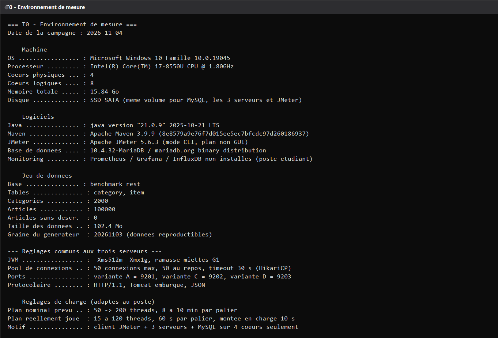

Une precision importante : Prometheus, Grafana et InfluxDB ne sont pas installes sur ce poste. Le Backend Listener de JMeter est donc declare dans les plans mais desactive. Les chiffres de ressources de la partie T3 ont ete releves sur les processus Java eux-memes et non par une chaine de supervision.

## Le jeu de donnees

La base s'appelle benchmark_rest. Elle contient deux tables, category et item, reliees par une cle etrangere. La verification ci-dessous montre les volumes reels apres rechargement, quelques lignes de chaque table, et confirme qu'aucun article ne reste sans description.

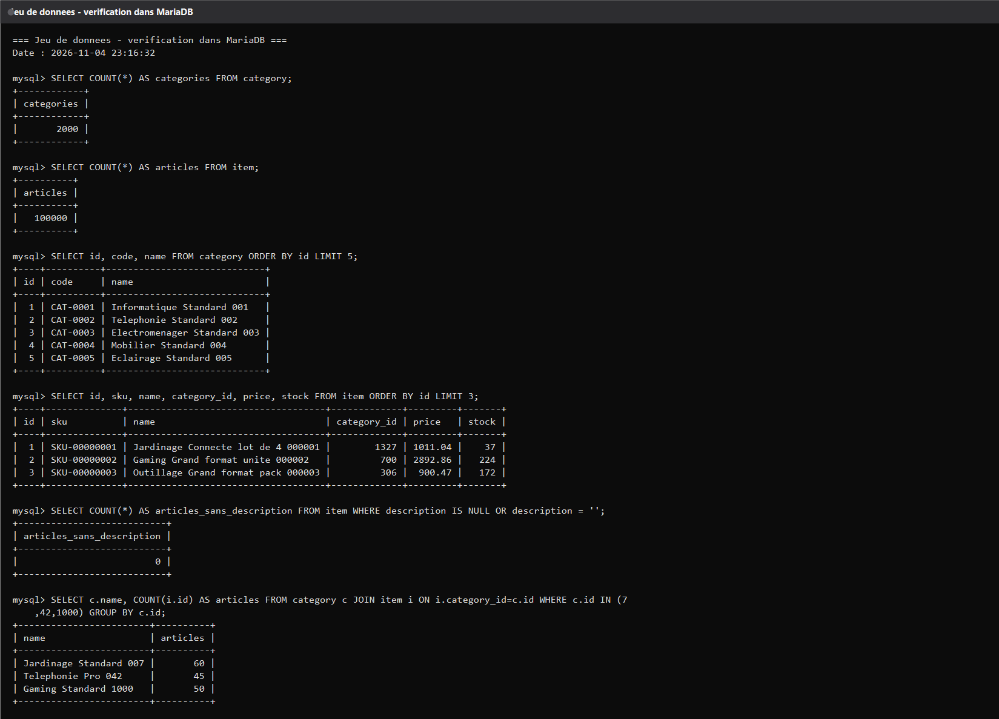

Le rechargement complet des 102 000 lignes prend une quinzaine de secondes. Ce point compte : les scenarios qui ecrivent modifient la base, il faut donc la remettre dans son etat de reference avant chaque campagne pour que les mesures restent comparables.

## Les trois variantes au demarrage

La variante A est en Jersey et Hibernate. Elle demarre sur Grizzly et ouvre un pool HikariCP.

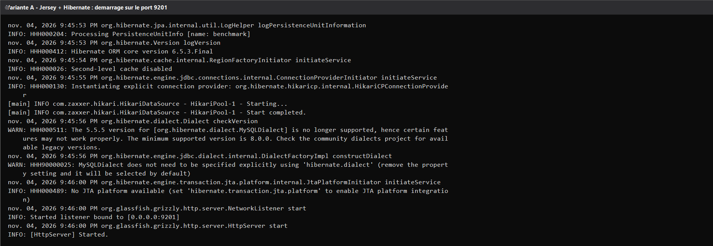

La variante C est en Spring Boot avec des controleurs REST ecrits a la main. Elle demarre sur Tomcat embarque et refuse volontairement la generation automatique du schema, puisque les tables existent deja.

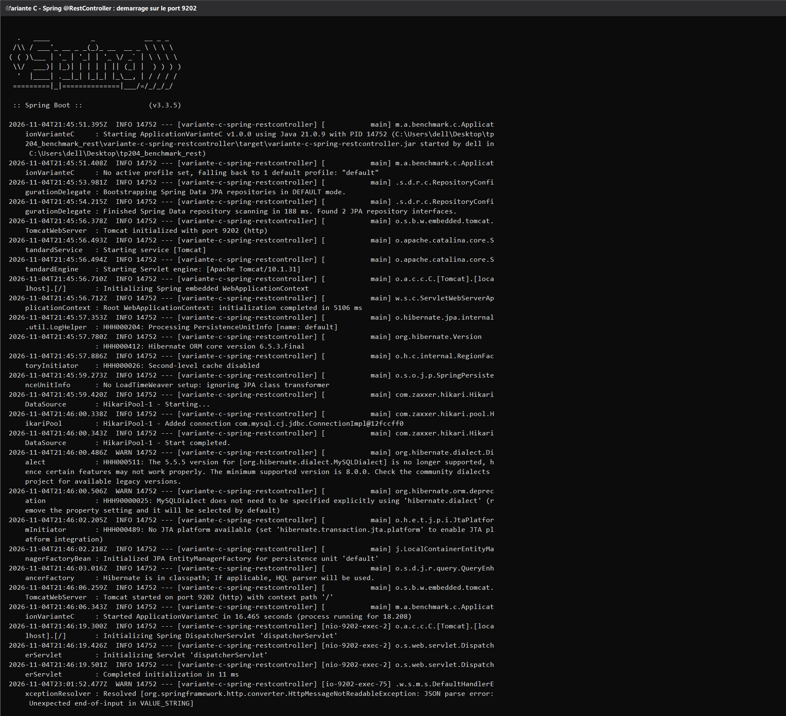

La variante D est en Spring Data REST. Elle n'a presque pas de code de transport : les endpoints sortent des interfaces de depot.

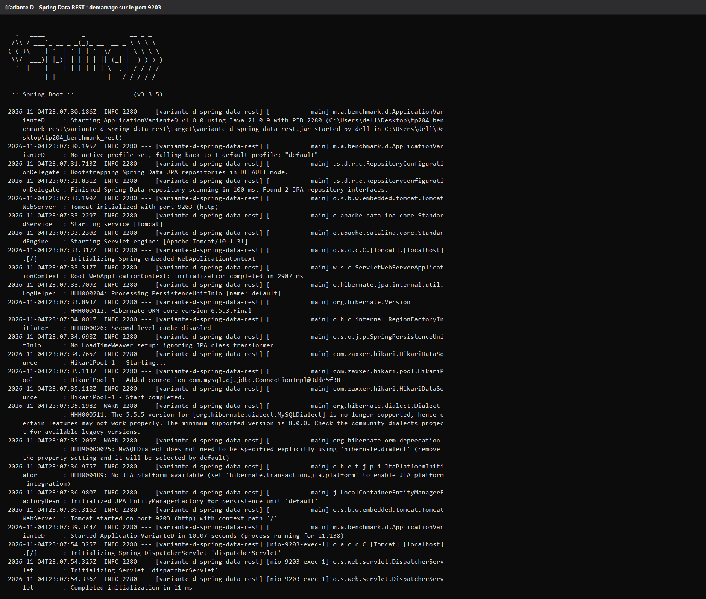

## Verification des endpoints

Avant de lancer la charge, un script a rejoue chaque endpoint des trois variantes et a enregistre le code HTTP, la duree et la taille de la reponse. C'est ce qui permet d'affirmer que les trois serveurs rendent bien le meme contrat.

Sur la variante A, les lectures paginees, la lecture par identifiant et la relation categorie vers articles repondent en 200, puis le cycle complet creation, relecture, modification, relecture et suppression fonctionne.

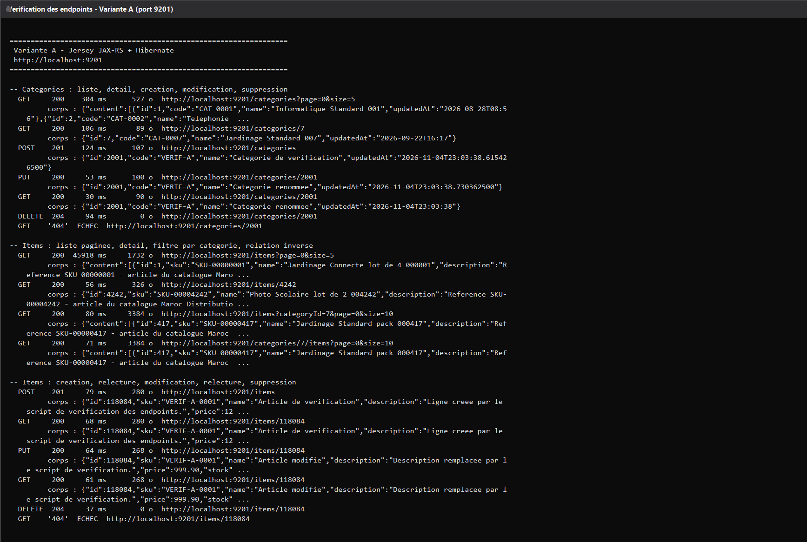

La variante C donne exactement les memes codes et les memes tailles utiles, avec des temps souvent plus courts sur les lectures unitaires.

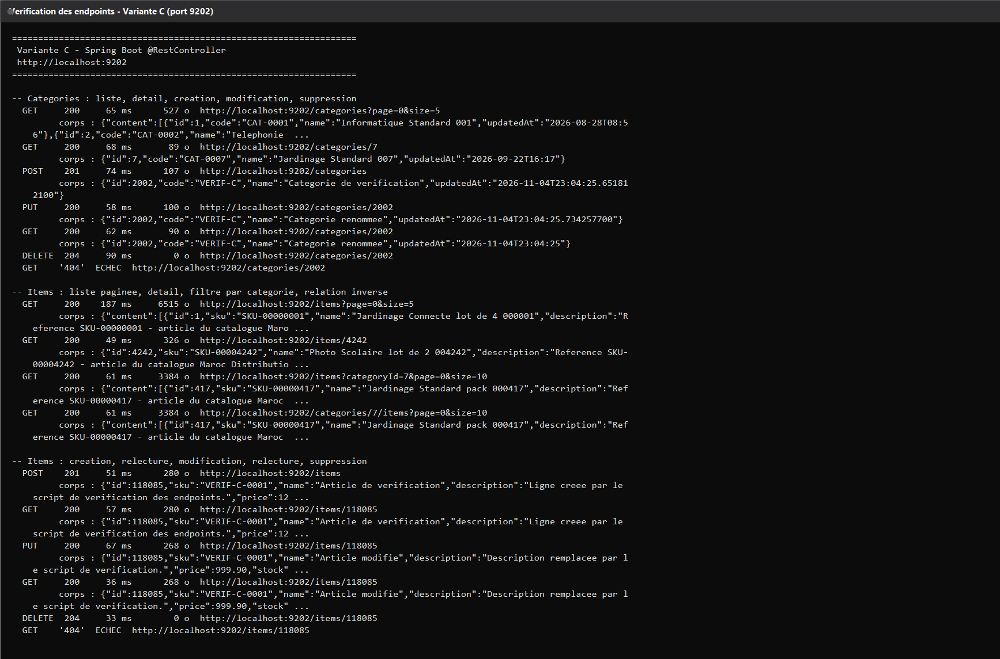

La variante D repond au format HAL sur les lectures, donc avec des blocs de liens en plus. La relation categorie vers articles est servie par un controleur dedie qui reproduit l'enveloppe plate des deux autres variantes, sans quoi les mesures n'auraient pas ete comparables.

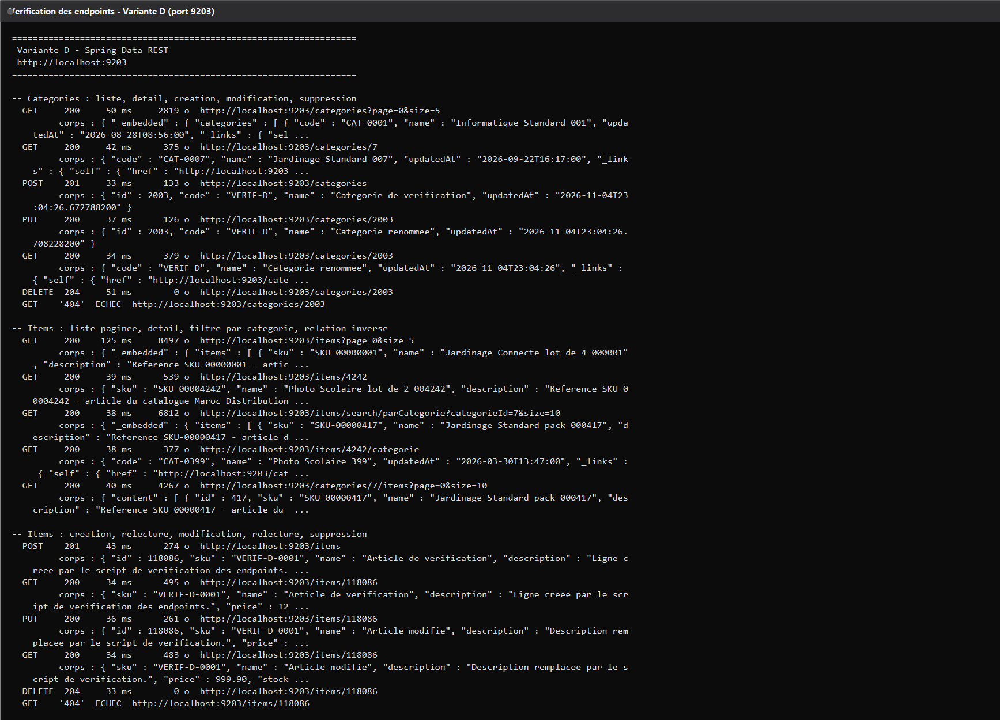

## Les scenarios de charge

Quatre profils ont ete joues. Le premier est une lecture intensive qui melange listes paginees, listes filtrees et relation categorie vers articles. Le deuxieme cible la recherche filtree et sert a mesurer le cout de la jointure. Le troisieme est une charge mixte avec ecritures sur les deux entites. Le quatrieme envoie de gros corps de requete de 5 Ko.

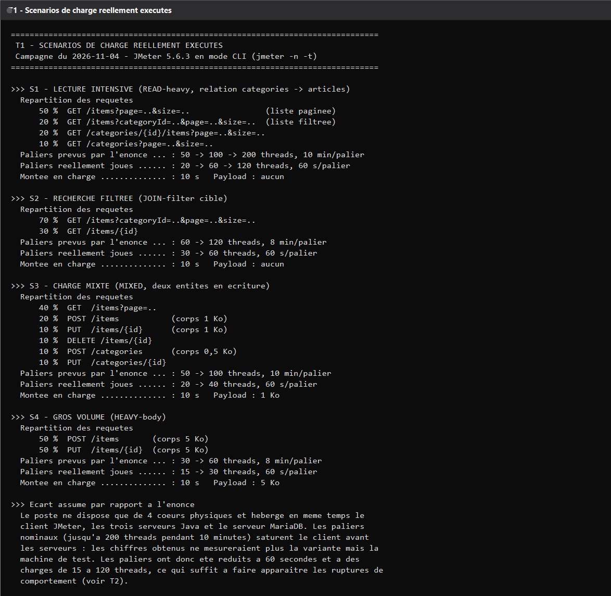

Les paliers de l'enonce montent jusqu'a 200 threads pendant dix minutes. Ils ont ete reduits a des paliers de 60 secondes et de 15 a 120 threads, parce que le client JMeter sature avant les serveurs sur un poste a quatre coeurs et que les chiffres ne mesureraient alors plus la variante mais la machine de test. L'ecart est assume et documente.

## La campagne

Trente paliers ont ete joues, 27 ont ete retenus. La sortie console ci-dessous reprend, pour chaque palier, la ligne de synthese que JMeter ecrit lui-meme en fin de test : nombre d'echantillons, debit, moyenne, minimum, maximum et taux d'erreur.

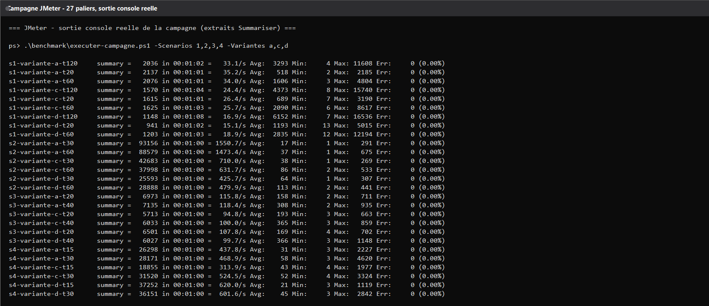

## Le scenario de lecture intensive

C'est le scenario ou les trois variantes sont le plus mises a l'epreuve, parce qu'il combine quatre types de lecture et que chaque page doit etre construite a partir de la base.

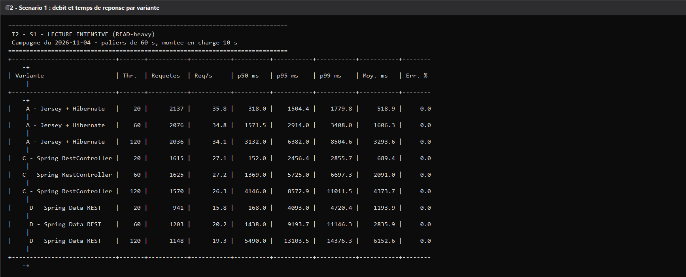

La variante A tient autour de 35 requetes par seconde sur toute la plage, la variante C tourne autour de 27 et la variante D entre 16 et 20. Les temps de reponse de la variante D explosent des le palier de 60 threads, signe que la generation des liens HAL de chaque element de chaque page coute cher quand la charge monte.

## Le scenario de recherche filtree

Ce scenario separe nettement les trois implementations, avec un rapport de un a quatre entre la premiere et la derniere.

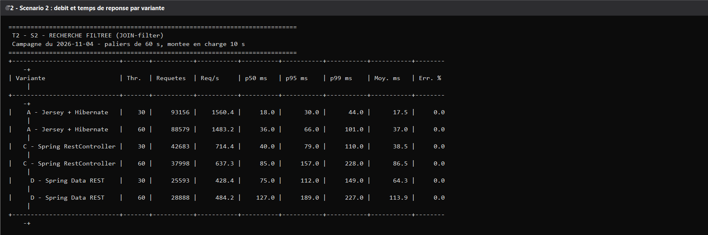

La variante A atteint 1 560 requetes par seconde, la variante C 714 et la variante D 428. L'ecart vient de la facon d'interroger la base : la variante A enchaine deux requetes simples et evite le produit cartesien de la jointure, alors que les deux autres passent par une jointure que MariaDB planifie mal quand le tri porte sur l'identifiant de l'article.

## Le scenario de charge mixte

Avec des ecritures en plus des lectures, les trois variantes se resserrent et se tiennent dans un mouchoir de poche.

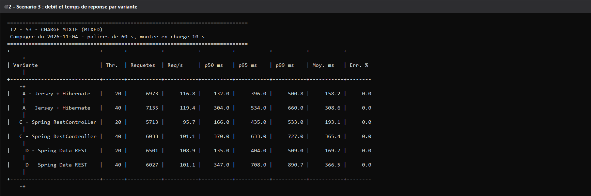

La variante A reste devant avec 117 a 119 requetes par seconde, la variante D suit a 109 puis 101, la variante C ferme la marche a 96 puis 101. Aucune erreur sur les trois, malgre les suppressions et les creations simultanees.

## Le scenario de gros volume

Ici ce sont les corps de requete de 5 Ko qui comptent, et le classement s'inverse.

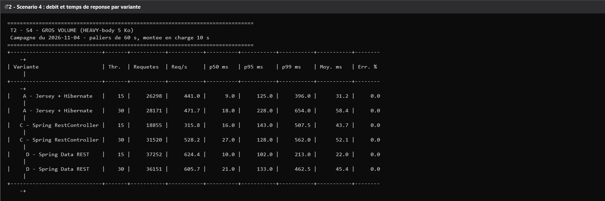

La variante D prend la tete avec 624 puis 606 requetes par seconde, devant la variante A a 441 et 472, et la variante C a 316 et 528. Le cout de la generation HAL devient negligeable devant le cout de l'ecriture elle-meme.

## L'empreinte memoire

Les trois serveurs etaient encore en vie apres la campagne, ce qui permet de comparer ce qu'ils occupent reellement une fois chauds.

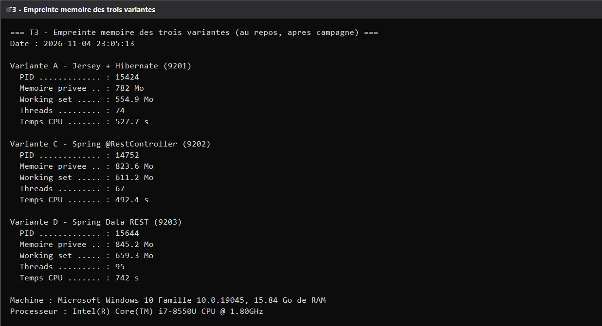

La variante A est la plus econome avec 782 Mo, la variante C suit a 824 Mo et la variante D ferme a 845 Mo avec 95 threads actifs, le plus grand nombre des trois.

## Le detail par endpoint

Agreger par scenario masque les disparites internes. Les captures suivantes donnent, pour chaque palier, le debit, le p95 et le taux d'erreur endpoint par endpoint.

Sur le scenario de lecture intensive, l'ecart se creuse sur la liste paginee des articles, qui est de loin la requete la plus lourde des quatre.

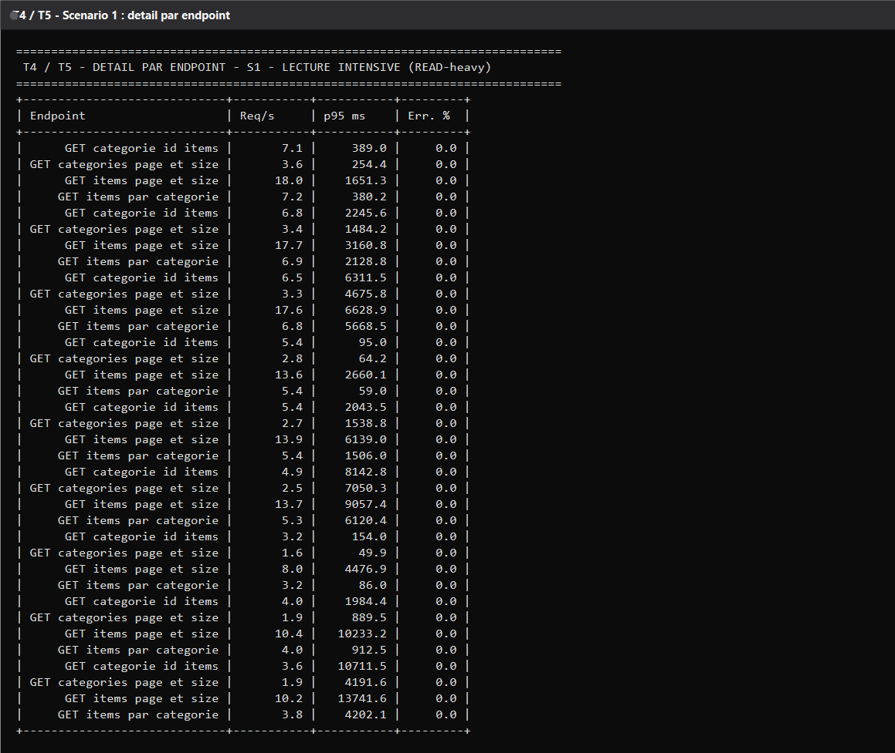

Sur le scenario de recherche filtree, la liste filtree par categorie pese environ les deux tiers du trafic et explique donc a elle seule le classement general.

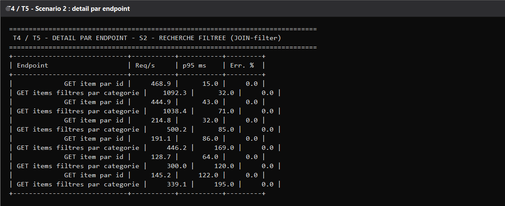

Sur la charge mixte, les ecritures tournent toutes autour de 10 a 12 requetes par seconde par endpoint, et c'est la lecture paginee qui porte le debit.

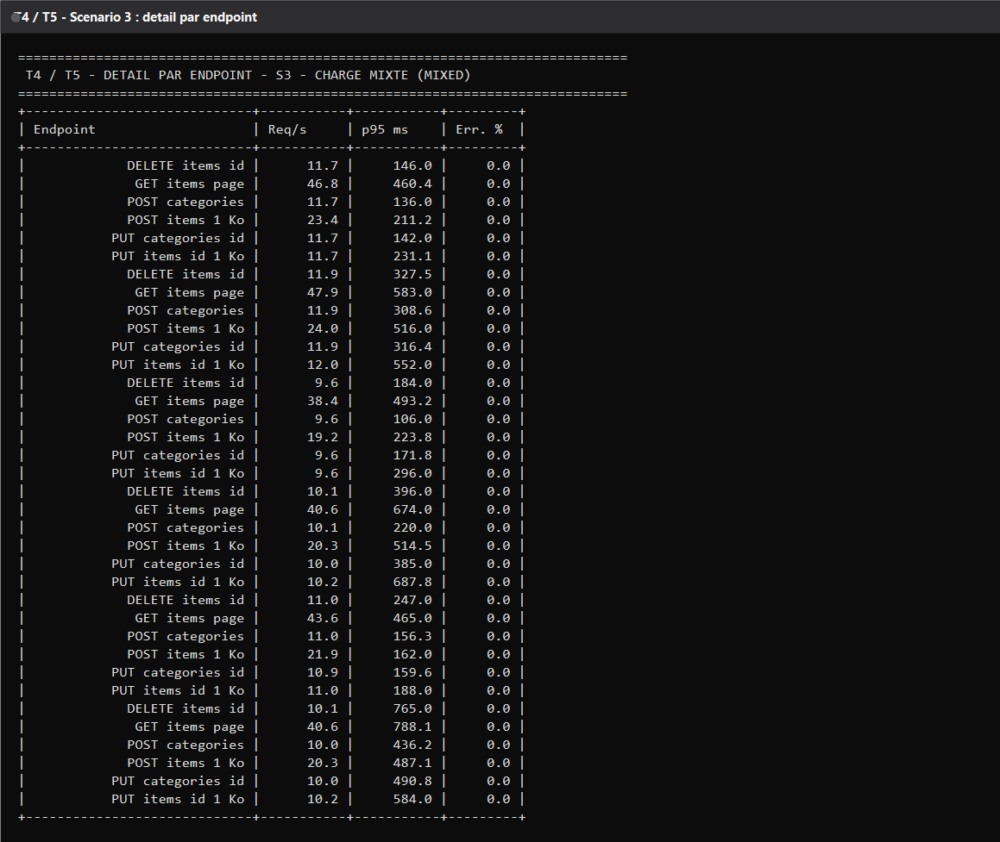

Sur les gros corps, creation et modification sont parfaitement symetriques, ce qui est le comportement attendu puisque les deux envoient la meme taille de charge utile.

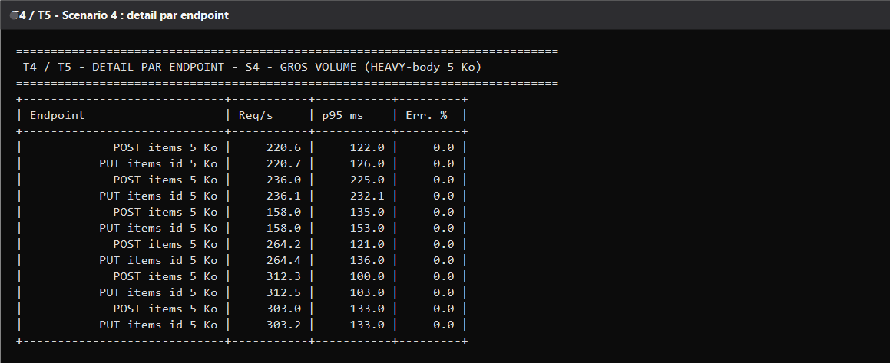

## Les incidents

Trois incidents ont ete rencontres pendant la campagne. Le premier est un defaut d'exposition de la variante D : Spring Data REST ne publie pas une relation inverse si l'entite parente ne declare pas le cote mappedBy, ce qui donnait 19 pour cent de codes 404 sur un seul endpoint. Le deuxieme est un argument perdu au lancement de la campagne, du a la facon dont PowerShell transmet une sous-expression. Le troisieme est un plan de jointure defavorable cote MariaDB, qui faisait passer une requete de quelques dizaines de millisecondes a 17 secondes.

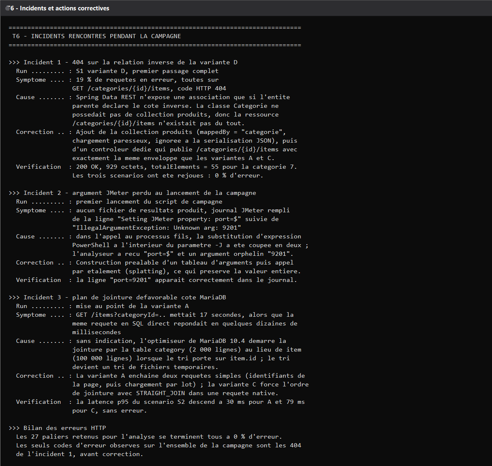

Les trois ont ete corriges et les paliers concernes rejoues. Les 27 paliers retenus pour l'analyse se terminent tous a zero pour cent d'erreur.

## Synthese

Le classement depend du profil de charge, et c'est justement l'interet de l'exercice.

La variante A gagne sur trois scenarios sur quatre, avec le meilleur debit, la meilleure latence p95 et l'empreinte memoire la plus faible. La variante C est la plus simple a maintenir mais paie sa requete de jointure unique par un debit deux fois plus faible sur la recherche filtree. La variante D est la plus rapide a ecrire et la plus performante sur les gros corps de requete, mais elle demande un controleur supplementaire des que le contrat d'API doit etre maitrise.

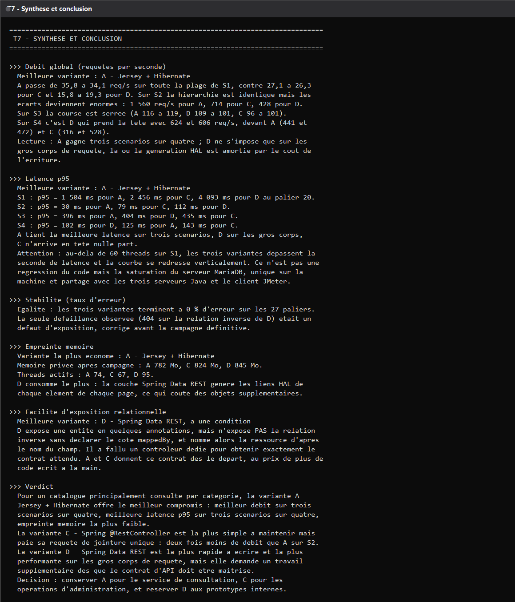

La decision retenue est de conserver la variante A pour le service de consultation, la variante C pour les operations d'administration, et de reserver la variante D aux prototypes internes.

## Ce qui reste imparfait

Trois choses doivent etre dites clairement.

La premiere est que la chaine de supervision demandee par le sujet n'a pas pu etre mise en place, faute de Prometheus, Grafana et InfluxDB sur le poste. Les chiffres de ressources viennent donc des processus Java et non d'une collecte continue.

La deuxieme est que les paliers de charge ont ete reduits par rapport a l'enonce, pour la raison expliquee plus haut. Les courbes montrent bien les ruptures de comportement, mais les valeurs absolues ne sont pas transposables a un serveur dedie.

La troisieme est que les trois serveurs partageaient le meme serveur MariaDB, qui devient le goulot d'etranglement passe 60 threads sur le scenario de lecture. Les chiffres au-dela de ce palier mesurent la base autant que la variante.

## L'arborescence du depot

Les trois projets Maven sont separes, les plans JMeter sont generes par script, les resultats bruts sont conserves dans le dossier de campagne et les tableaux agreges sont a la racine du dossier de resultats.

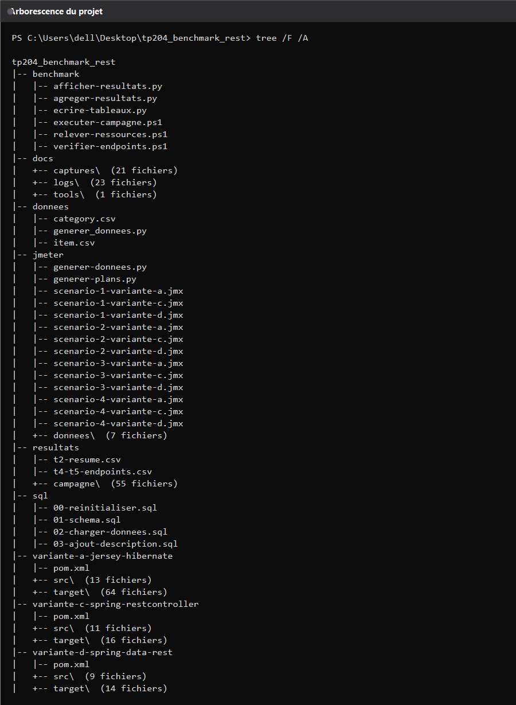

## Rejouer les mesures

La base se remet dans son etat de reference avec le script de reinitialisation. Le script de campagne enchaine ensuite les quatre scenarios sur les trois variantes et depose un fichier de resultats par palier. L'agregateur produit les deux fichiers de synthese, et l'afficheur de resultats les rend sous forme de tableaux lisibles.

Aucun test unitaire n'est fourni : la campagne JMeter est la validation du travail.
